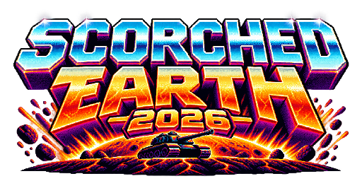

# Scorched Earth 2026

A complete Talus game template for a side-scrolling, turn-based artillery game.
It demonstrates how to build tightly controlled game rules around a continuously
simulated world: scripts schedule turns, native controllers move tanks, graphs
fire weapons, and reactive HTML menus expose the state.



## Open and play

Import [the complete project](project/scorched-earth-2026.talus) into Talus. Open
Indigo to edit, or launch its title screen and choose **New game**. Choose a
seed or let the engine randomize it, select human and CPU players, then press **Start match**.
A CPU-only opening armory purchases supplies and starts automatically. Human
players can shop before pressing **Begin Match**. **Resume saved game** appears when a
saved game is available.
CPU-only series also buy supplies and deploy the next round automatically;
the completed series remains on its results screen.

The battlefield is 50 WFC tiles wide and 5 tall. Tiles are 256×256 pixels with a
solid stone foundation. Generation can also use zones, mazes and noise-driven
brush landscapes with semantic, neural, living and vector details. Advanced
setup exposes the terrain parameters.

- Two to sixteen tanks compete. Each gets a timed turn to move, aim and shoot.
- Shooting ends the tank's input period; the projectile and its effects resolve
  before the next turn. Camera movement follows the action smoothly.
- Tanks announce shots and deaths, with three seconds for their lines before
  firing or exploding. Death can trigger a destructive chain reaction.
- The last living tank wins. Falling outside the battlefield eliminates a tank.
- Actions earn cash, including firing, impacts, hits, damage and death. Spend it
  in the armory on weapons, ammunition, shields, fuel and other utilities.
- Named wallets, stock and scores persist between plays. CPU personas choose
  tactics, shop, explore and learn from their shots.
- Rare payloads add roaming worms, attacking crows, explosive sheep, mines,
  airstrikes, bouncing water ducks, meteors and a cash-stealing Tax Collector.

Use the on-screen angle, power, weapon and utility controls. Menus support mouse,
keyboard and gamepad navigation; **Options → Controls** shows and changes the
bindings. **Quit now** leaves immediately without saving; **Save & title**
preserves progress when the battle is at a saveable boundary. [Input configuration](world/Game/input.json) supplies the defaults.

## Find your way around

The **Template guide** annotation above the battlefield is visible only in the
editor. Cmd/Ctrl-click its links to visit tile origins or inspect read-only
excerpts of game files and the native tank asset. Its source is
[world/Guide.md](world/Guide.md).

| Location | Contents |
| --- | --- |
| [world/Scripts/main.ts](world/Scripts/main.ts) | Playable-instance entry point |
| [world/Scripts/lib](world/Scripts/lib) | Game services, composed by `game.ts` with boundaries in `context.ts` |
| [world/Game](world/Game) | Rules, shop, personas, dialogue catalogs, terrain parameters and input |
| [world/Game/Presets](world/Game/Presets) | Project-owned noise, semantic, neural, living, vector and material resources |
| [world/Menus](world/Menus) | Title, setup, shop, HUD, pause, controls and shared arcade styling |
| [world/Graphs](world/Graphs) and [world/Dialogue](world/Dialogue) | Native CPU action graph and Ink announcer stories |
| [world/WFC](world/WFC) | Square tile scaffold, connector spans, palette references and artist instructions |
| [assets/native](assets/native) | Current tanks, weapon/mod templates, animation clips/controllers, factions and material definitions |
| [assets/sprites](assets/sprites), [assets/art](assets/art), [assets/audio](assets/audio) | Small pixel sprites, editable art and sound sources |
| [project.json](project.json) | Root and Title world identities, source and archive locations |
| [tools](tools) and [tests](tests) | Authoring commands, source audits and game/native behavior checks |

The root world owns the battlefield and game library. Its **Title** child world
is bound to `menu:title`, filling the window behind the title controls. The logo
retains its imported colors while seeded wood, dynamite and emitter stripes
burn and explode. Edit Title through the project world switcher.

The file tree and complete archive serve different purposes. `world/` is readable
source for scripts and configuration. Native terrain pixels, child worlds,
scoped resources, joints and scene bindings travel in the `.talus` archive.
Save and export after editing native data; copying the mounted files alone
cannot capture the whole project.

## Customize the template

Start with [arena rules](world/Game/arena.json), [the armory](world/Game/shop.json),
[personas](world/Game/personas.json) and [terrain settings](world/Game/generation.json).
The scripts use native Talus features for physics, streaming, animation,
particles, weapon planning and persistence. The game owns turn sequencing,
rewards, CPU strategy and presentation policy.

Read [architecture](docs/architecture.md) for service responsibilities and state
ownership, [equipment](docs/equipment.md) for tanks and aiming, and
[terrain](docs/terrain.md) before painting tile edges. The
[authoring guide](docs/authoring.md) explains file synchronization, native records
and resource capture. [Publishing](docs/publishing.md) covers complete exports,
unsigned installers and website output.

## Work on the source

Use Node.js 24 or newer and install dependencies with `npm ci`.
Open the imported project in Talus, then use its authenticated local bridge:

```sh
node tools/project.cjs types
node tools/talus_sync.cjs status
npm run check
npm run audit
```

Follow [authoring](docs/authoring.md) to capture or install reviewed source.
Run `node tools/menus.cjs` after editing shared CSS. Read
[validation](docs/validation.md) for native solver tests and visual checks.
Keep build outputs in ignored `dist/`, working reports in `.build/`, and bridge
credentials in the native Talus profile. The repository contains no player
accounts or local credentials.
